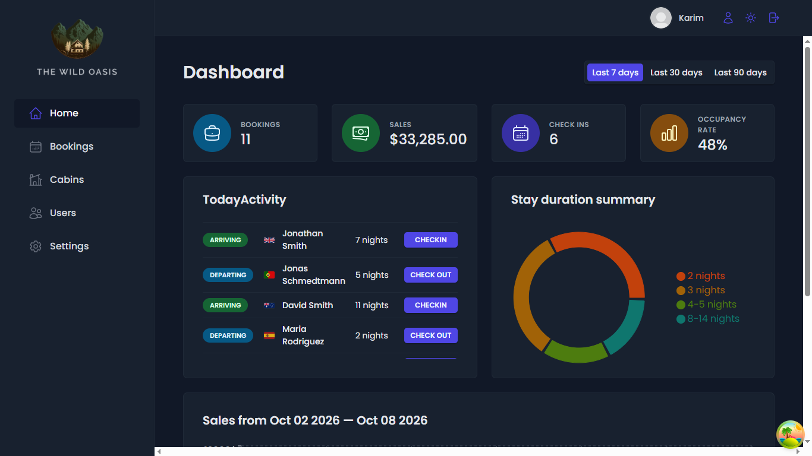
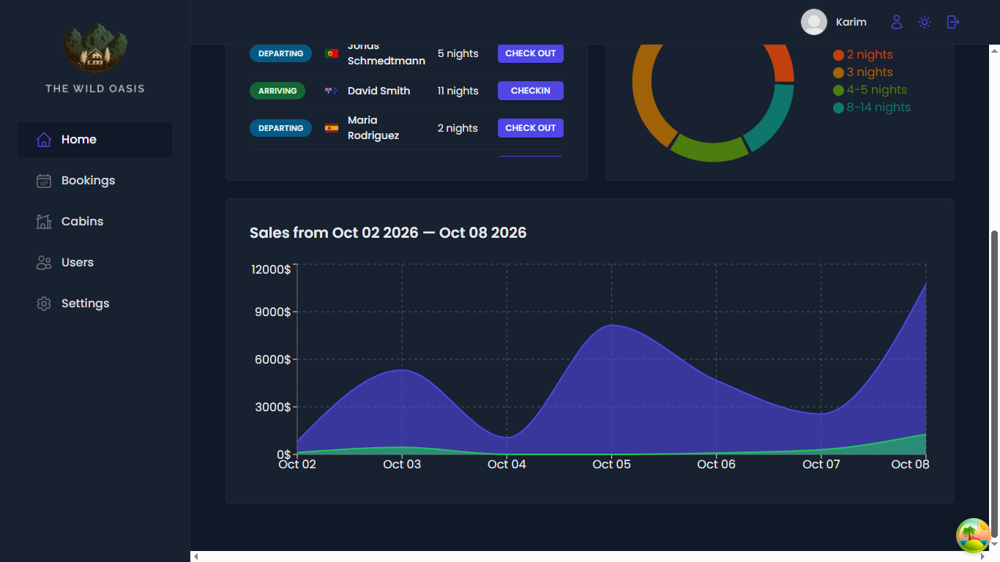
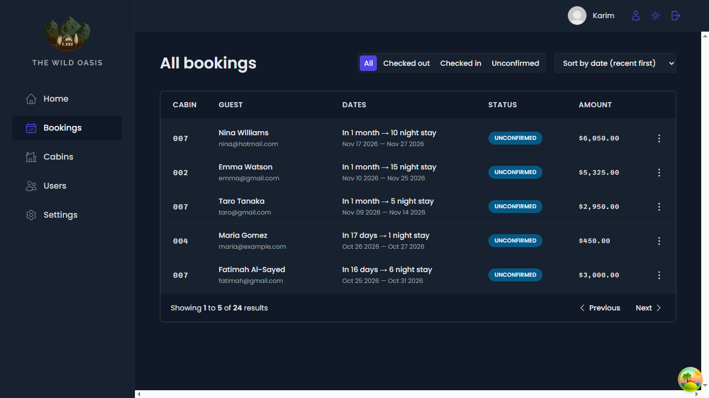
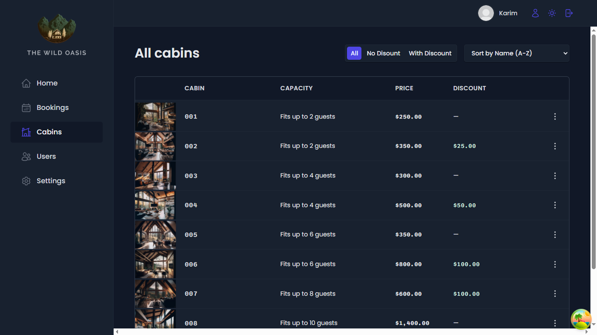

# 🏕️ The Wild Oasis

The Wild Oasis is a full-stack internal hotel management dashboard built with React. Hotel employees can manage bookings, check guests in and out, oversee cabins, and track hotel statistics through a clean, modern interface.

Built as the capstone project of [The Ultimate React Course](https://www.udemy.com/course/the-ultimate-react-course/) by Jonas Schmedtmann.

> **Note:** There is no public live demo, to prevent database vandalism (deleting or adding data). Run the project locally using the steps below.

## 📸 Screenshots

### Dashboard



### Bookings


### Cabins


## ✨ Features

- **Authentication:** Email/password login with protected routes, powered by Supabase Auth.
- **Dashboard:** Hotel statistics (sales, occupancy, stay durations) shown with interactive Recharts charts.
- **Cabin management:** Create, edit, duplicate, and delete cabins, with image upload to Supabase Storage.
- **Booking management:** Filtering, sorting, and pagination for all bookings.
- **Check-in / check-out:** Flows for guest arrivals, departures, and breakfast payments.
- **User settings:** Update profile data, avatar, and password, and manage hotel settings.
- **Dark mode:** Toggle between light and dark themes, using React Context and CSS variables.
- **Error handling:** Global error boundary with a fallback page, plus toast notifications for failed requests.
- **Responsive UI:** Clean layout with loading states and smooth transitions.

## 🛠️ Tech Stack

**Frontend**
- React 18 (Hooks)
- Vite
- React Router v6
- TanStack Query (React Query) v5
- Styled Components
- React Hook Form
- react-error-boundary

**Backend**
- Supabase PostgreSQL
- Supabase Auth
- Supabase Storage (cabin images and user avatars)

**Libraries**
- Recharts
- date-fns
- React Hot Toast
- React Icons

## 🚀 Getting Started

### Prerequisites

- Node.js v18 or higher
- npm
- A free [Supabase](https://supabase.com) account

### 1. Clone and install

```bash
git clone https://github.com/alire1992/the-wild-oasis.git
cd the-wild-oasis
npm install
```

### 2. Set up Supabase

1. Create a new project at [supabase.com](https://supabase.com) and wait for it to finish initializing.
2. Go to **Project Settings → API** and copy your project URL and anon public key.
3. Create a `.env` file in the project root:

   ```env
   VITE_SUPABASE_URL=your_project_url
   VITE_SUPABASE_ANON_KEY=your_anon_public_key
   ```

4. In the **SQL Editor**, create the `cabins`, `bookings`, `guests`, and `settings` tables (the schema is in the course materials).

### 3. Set up Storage

Create two **public** buckets in the **Storage** tab:

| Bucket | Used for |
| --- | --- |
| `cabin-images` | Cabin photos |
| `avatars` | User profile pictures |

Then allow signed-in users to upload and manage files by running this in the SQL Editor:

```sql
create policy "Authenticated users can read files"
on storage.objects for select to authenticated
using (bucket_id in ('cabin-images', 'avatars'));

create policy "Authenticated users can upload files"
on storage.objects for insert to authenticated
with check (bucket_id in ('cabin-images', 'avatars'));

create policy "Authenticated users can update files"
on storage.objects for update to authenticated
using (bucket_id in ('cabin-images', 'avatars'))
with check (bucket_id in ('cabin-images', 'avatars'));

create policy "Authenticated users can delete files"
on storage.objects for delete to authenticated
using (bucket_id in ('cabin-images', 'avatars'));
```

Also upload an image named `default-user.jpg` to the `avatars` bucket. It is used as the fallback avatar for users without a profile picture.

### 4. Create a user

In the Supabase dashboard go to **Authentication → Users → Add user** and create an account with your own email and password. Use it to log in.

### 5. Seed sample data (optional)

If your project includes the course's data uploader component, use it once to fill the database with sample cabins, guests, and bookings. Remove it afterwards.

### 6. Run the app

```bash
npm run dev
```

Open [http://localhost:5173](http://localhost:5173).

## 📁 Project Structure

```text
src/
├── features/   # Feature folders (cabins, bookings, check-in, dashboard, authentication, settings)
├── ui/         # Reusable UI components (Button, Modal, Table, Menus, ...)
├── services/   # Supabase API calls
├── hooks/      # Custom hooks (useMoveBack, useOutsideClick, ...)
├── context/    # React Context (DarkModeContext)
├── utils/      # Helpers and constants
├── styles/     # Global styles and theme
└── App.jsx     # Routing and app setup
```

## 🤔 Lessons Learned

- Building reusable UI with **compound components** (Modal, Menus, Table).
- Managing server state with **TanStack Query**: caching, mutations, and query invalidation.
- Structuring a larger app with a **feature-based** folder layout.
- Handling forms and validation with **React Hook Form**.
- Implementing **dark mode** with React Context and CSS variables.
- Securing data with Supabase **Row Level Security** and Storage policies.
- Debugging real-world issues such as invalid Storage keys and missing bucket policies.

## 🙏 Acknowledgments

- [Jonas Schmedtmann](https://github.com/jonasschmedtmann) for the course, design, and architecture guidance.
- [Supabase](https://supabase.com) for the backend platform.

## 📄 License

This project is open source and available under the [MIT License](./LICENSE).

---

<div align="center">
  Made with ❤️ and lots of ☕ by <strong>Alireza Saedi</strong>
  <br>
  <a href="https://www.linkedin.com/in/alireza-saedi-dev/">LinkedIn</a> •
  <a href="https://github.com/alire1992">GitHub</a>
</div>